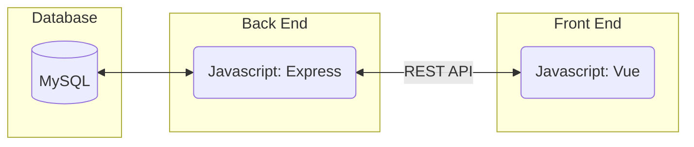
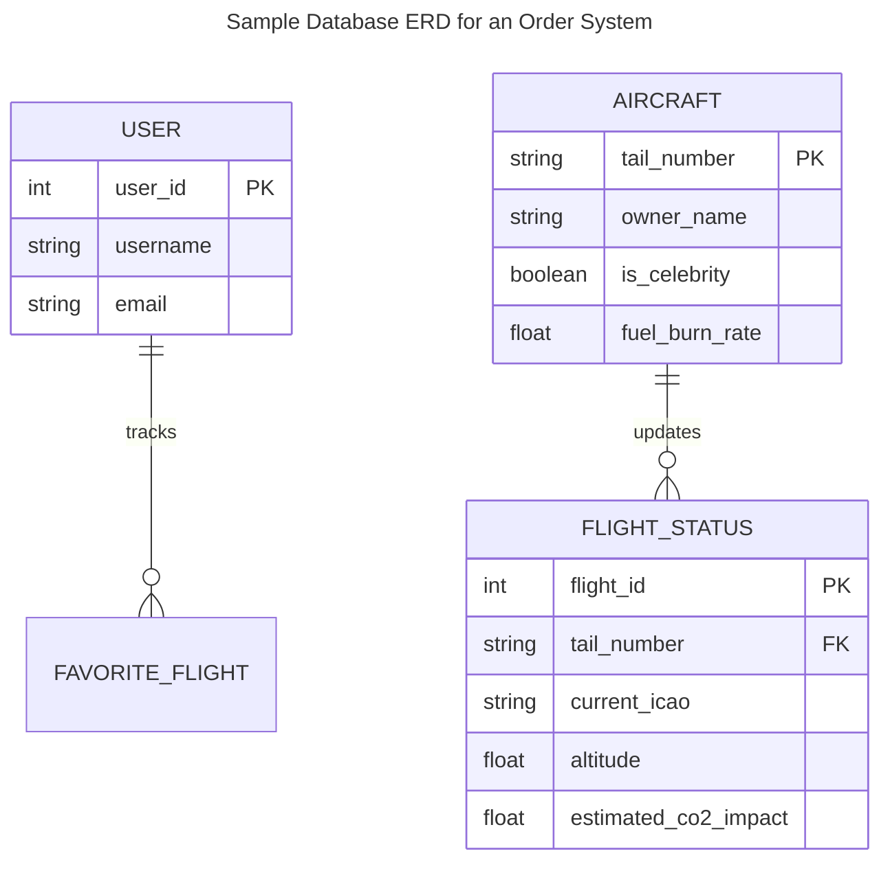
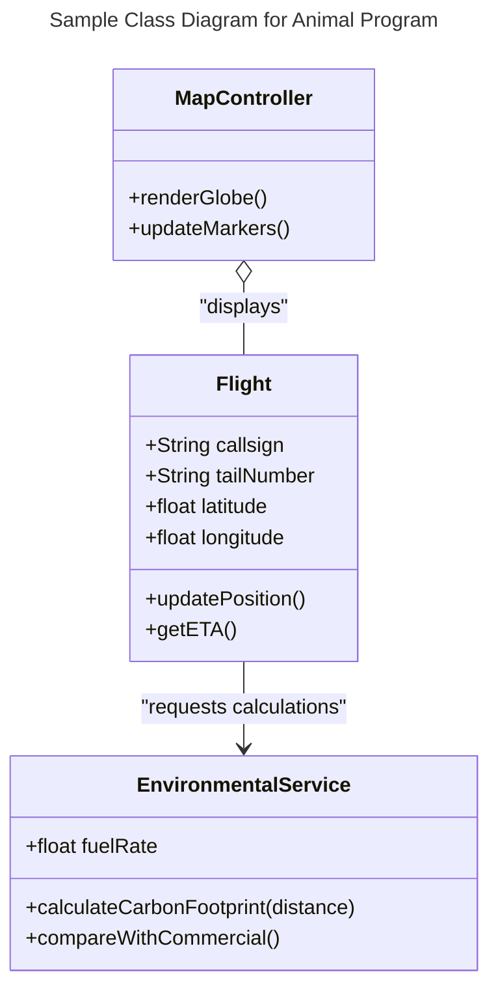
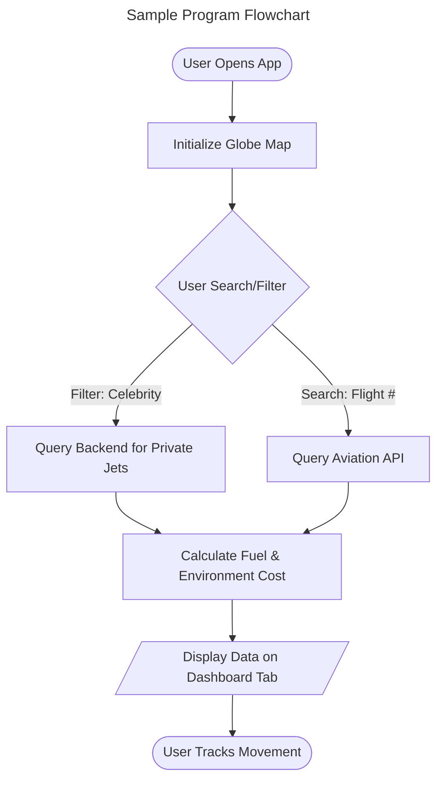
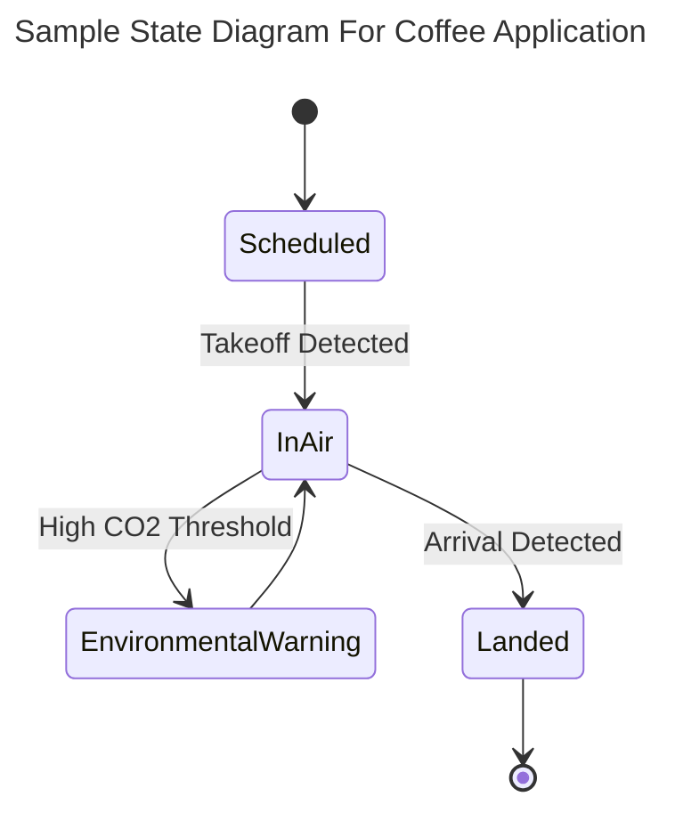
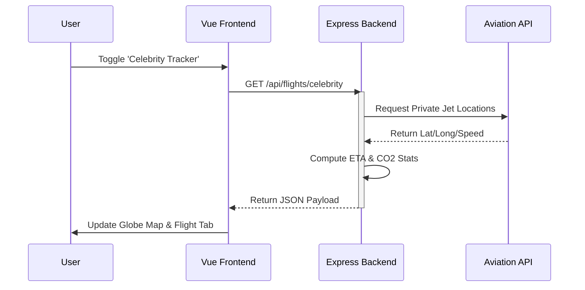

# Specification Document

Please fill out this document to reflect your team's project. This is a living document and will need to be updated regularly. You may also remove any section to its own document (e.g. a separate standards and conventions document), however you must keep the header and provide a link to that other document under the header.

Also, be sure to check out the Wiki for information on how to maintain your team's requirements.

## TeamName

# 404 Flight Not Found

### Project Abstract
 
This web application is a real-time flight tracking system that allows users to search for and monitor flights based on flight number, airline, or specific points of interest such as celebrity private jets. The system retrieves live flight data from a public aviation API and displays key information including current location, route, altitude, speed, departure and arrival airports, and flight status. Users will be able to visualize flights on an interactive map, save favorite flights to track over time, and receive updated status information. The goal of the software is to provide an intuitive and engaging way for users to follow aircraft movement in real time through a personalized and user-friendly interface.

### Customer

The general customers for this system include aviation enthusiasts, travelers tracking flights, fans interested in monitoring celebrity aircraft, and users who want real-time updates on aircraft movements. These users value accurate, up-to-date flight information presented in a clear and interactive format.

For this project, the primary customer is the CS506 instructional staff, who are acting as stakeholders providing requirements and feedback. They represent typical end users by emphasizing usability, real-time data access, and clear system functionality. The system will be designed to meet their expectations for functionality, reliability, and ease of use.

### Specification

<!--A detailed specification of the system. UML, or other diagrams, such as finite automata, or other appropriate specification formalisms, are encouraged over natural language.-->

<!--Include sections, for example, illustrating the database architecture (with, for example, an ERD).-->

<!--Included below are some sample diagrams, including some example tech stack diagrams.-->

#### Technology Stack

Our chosen tech stack:




#### Database



#### Class Diagram



#### Flowchart



#### Behavior



#### Sequence Diagram



### Standards & Conventions

<!--This is a link to a seperate coding conventions document / style guide-->
[Style Guide & Conventions](STYLE.md)

### Development & Deployment Workflows

For local development with fast hot-reloading:

- **`make dev`**: Starts MySQL and phpMyAdmin in Docker only. After it reports that the DB is ready, run:
  - **Backend**: `cd backend && ./gradlew bootRun`
  - **Frontend**: `cd frontend && npm run dev`

For a production-like deployment of the full stack:

- **`make deploy`**: Builds and runs the full Docker stack (frontend, backend, db, phpMyAdmin) using Docker Compose.

You can also run **`make help`** to see all available Makefile targets and a short description of each.

---

## High-Level Architecture Overview

The application is a real-time flight tracking UI backed by a Spring Boot service and a MySQL database. The frontend renders flight markers on a Leaflet map and maintains interactive state (selected flight + watchlist). To reduce external API rate-limit pressure, the frontend prefers a DB-backed cache of “recent flights”.

```mermaid
flowchart LR
  subgraph Frontend[Frontend (Vue)]
    Home[HomeView.vue] --> DBCache[GET /api/db/flights/cache]
    Home --> Search[GET /api/flights/search]
    Home --> Persist[POST /api/db/flights/batch]
    Home --> Map[MapContainer.vue + Dashboard.vue]
  end

  subgraph Backend[Backend (Spring Boot)]
    DbController[DbController (/api/db/*)] --> MySQL[(MySQL)]
    DemoController[DemoController (/api/* proxies)] --> ExternalAero[FlightAware AeroAPI]
    DemoController --> ExternalLive[airplanes.live]
  end

  Frontend -->|HTTP| Backend
  Backend -->|queries/writes| MySQL
```

Key behaviors:
- **DB-first cache**: the frontend tries `/api/db/flights/cache` before calling FlightAware.
- **External proxy**: `/api/flights/*` and `/api/airports/*` are thin proxies to FlightAware AeroAPI that return raw JSON text.
- **DB persistence**: fetched/transformed flight marker records are persisted via `/api/db/flights/batch`.

## How to Start

### Prerequisites
- Docker + Docker Compose
- A value for `AEROAPI_KEY` (FlightAware). The backend reads it via env var / `.env`.

### Option A: Local dev (Docker DB only)
1. Start MySQL + phpMyAdmin:
   - `make dev`
2. In a separate terminal, run the backend:
   - `cd backend && ./gradlew bootRun`
3. In another terminal, run the frontend:
   - `cd frontend && npm run dev`
4. Visit:
   - Frontend: `http://localhost:5173`
   - Backend: `http://localhost:8080/api/hello`

Why this approach:
- DB is containerized for consistency, while frontend/backend run locally for faster iteration.

### Option B: Full stack (Docker for everything)
- `make deploy`
- Then visit:
  - Frontend: `http://localhost:5173`
  - phpMyAdmin: `http://localhost:8081`

### Run tests
- Backend: `cd backend && ./gradlew test`
- Frontend: `cd frontend && npm test`

Note:
- There are “manual” integration tests tagged in both projects that may require real API keys and network access.

## Directory Map (Docs)

- `[backend/Backend-API-Reference.md](backend/Backend-API-Reference.md)`: backend API overview + setup notes
- `[backend/db/Database-Schema-Initialization.md](backend/db/Database-Schema-Initialization.md)`: MySQL schema initialization/evolution details
- `[backend/db/DB_CONTROLLER.md](backend/db/DB_CONTROLLER.md)`: detailed DB-layer controller behavior and endpoint expectations
- `[frontend/Frontend-Overview.md](frontend/Frontend-Overview.md)`: frontend setup + Vitest testing strategy
- `[frontend/src/__tests__/Frontend-Unit-Tests.md](frontend/src/__tests__/Frontend-Unit-Tests.md)`: per-test-file explanation for the FE test suite
